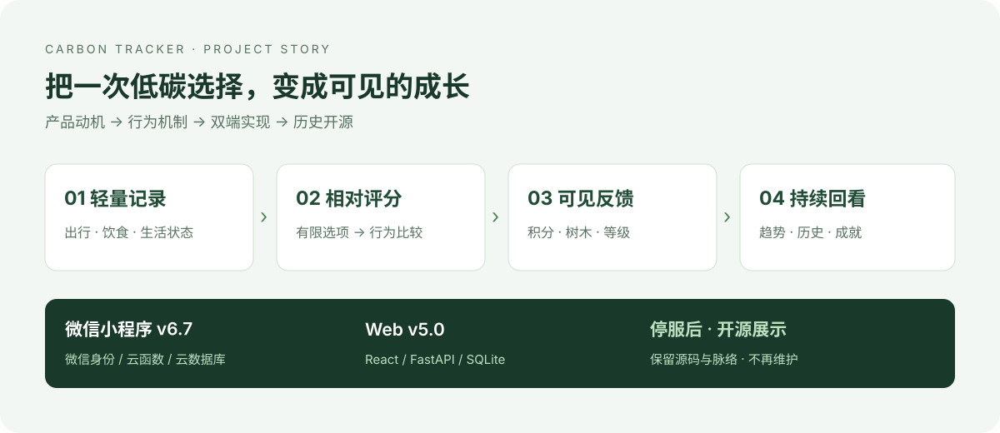

# 碳迹绿行 · Carbon Tracker

> 把一次低碳选择，变成可见的成长。

碳迹绿行是一个围绕日常行为记录、相对碳评分与虚拟森林反馈开发的双端项目。它从课程与竞赛中的产品构想开始，逐步形成了微信小程序和 Web 应用：让用户用几次选择记录一天的出行、饮食与生活状态，再通过积分、树木、趋势与成就看到自己的行动。

**本仓库公开的是曾经开发过的项目。原 Web 与小程序服务均已停止，项目不再维护。** 保留源码和开发脉络，是为了展示产品如何从一个问题走到具体实现，也方便他人阅读、学习或自行改编。这里没有可用的官方线上入口，也不提供持续运营或维护承诺。

[](docs/publication-notes.md)
[](LICENSE)

| 本仓库保留什么 | 需要怎样理解 |
| --- | --- |
| 微信小程序 v6.7 | 原生小程序、微信云开发、13 个注册页面、8 个业务云函数与共享逻辑 |
| Web v5.0 | React + TypeScript 前端、FastAPI + SQLite 后端、独立账号与数据接口 |
| 项目故事与技术说明 | 解释为什么做、为什么这样取舍，以及哪些内容实际写进了代码 |
| 原有测试与依赖清单 | 帮助阅读和自行复现，不等于停服后的完整运行保障 |



_项目主线：先把行为记录下来，再让反馈变得可见，最后把这套机制落实到两个独立客户端。_

---

## 为什么做：知道应该低碳，和每天愿意行动之间，还有一段距离

项目的出发点，是一个很具体的产品问题：低碳倡议容易被理解，却不一定能进入日常习惯。

通勤时选择步行还是打车，吃饭时选择什么，今天主要在家还是出行，这些决定发生得很频繁。用户未必愿意为每次决定填写一张复杂的排放表；即使完成记录，也可能只得到一个难以理解的数字，很难知道自己做得怎样，更难产生第二天继续使用的动力。

因此，碳迹绿行把设计重点放在三个问题上：

- **能不能几秒钟完成一次记录？** 用有限选项代替复杂输入，降低第一步的成本。
- **能不能马上看到这次选择的反馈？** 把行为转成相对评分、积分与树木，而不是只留下一条日志。
- **能不能看见一段时间的变化？** 用历史、趋势、森林、等级与成就连接单次行为和持续参与。

这些是项目的设计动机。仓库没有提供能够证明长期行为改变或实际减排效果的研究数据，因此不把产品目标写成已经验证的成效。

---

## 一条核心链：每个环节为什么存在，又留下什么

```text
日常选择：出行 / 饮食 / 生活状态
                  ↓
轻量记录：把选择保存为一条行为
                  ↓
相对评分：为行为提供可解释的比较
                  ↓
可见反馈：积分 / 树木 / 等级 / 成就
                  ↓
持续回看：历史 / 趋势 / 森林 / 排行
                  ↓
再做一次选择，继续记录
```

### 1. 记录｜先让行动进入系统

入口围绕出行、饮食和生活状态组织。用户不必先理解排放因子或专业核算方法，只要表达“今天做了什么”。这一步留下结构化行为记录，后面的评分、统计与激励都从这里开始。

小程序承担随手记录的场景；Web 则保留更完整的导览和浏览空间。两个端共享产品主题，各自有实际的记录流程。

### 2. 评分｜让选择之间有一个直观的比较

项目采用 **0–10 的相对碳评分，越低表示模型中越低碳**。评分把有限的行为选项转成易于理解的反馈，再参与积分与树木计算。

这是一套行为激励规则。它没有结合实际里程、食物重量、电量与经过核验的排放因子，不能作为专业碳核算、碳资产或核证减排结果。界面或历史材料中的“减排”“绿色资产”等表述，应放在这个边界内理解。

两个端的具体参数不同：小程序使用加和规则与组合修正，Web 使用加权评分。开源时保留各自历史实现，没有把它们包装成同一套已统一的算法。完整规则见 [功能与评分说明](docs/features-and-scoring.md)。

### 3. 森林与积分｜让反馈留下形状

一条记录不只影响数字，还会生成树木成长反馈。树木值与评分反向关联，积分再驱动累计成长与等级。森林把原本分散的记录放在同一处，让用户能回看自己留下的轨迹。

这里的树木是虚拟反馈，并不对应真实植树、碳抵消交易或线下权益。

### 4. 趋势与成就｜把一次使用接成连续使用

统计页回答“这段时间的记录有什么变化”，历史页保留“我具体做过什么”，等级与成就则提供阶段性反馈。排行榜增加横向比较，小程序挑战提供短周期目标。

它们服务于持续参与的设计，但不能仅凭功能存在就宣称已经提升了留存率或培养了低碳习惯。Web 还保留部分未完成的成就卡片，小程序提醒仍需要有效模板配置；这些实现边界在文档中单独说明。

---

## 它是怎样一步步形成的

项目的演进有两条代码线和一条材料线。**小程序 v6.7、Web v5.0 与项目文档 v3.0 是不同编号，不能按数字大小混为一次统一发布。**

| 阶段 | 当时要解决的问题 | 留下的变化 |
| --- | --- | --- |
| 早期构想与原型 | 低碳行为怎样变成可参与的产品？ | 出现跨平台 App 方案和 Web 原型，确定相对评分与可视化反馈方向 |
| 聚焦微信小程序 | 怎样让记录更容易进入日常使用？ | 将用户、记录、评分、数据和激励拆为明确模块，实际采用微信云开发 |
| 小程序 v4 → v5.1 | 怎样形成能够展示的完整核心循环？ | 页面由 7 个增加到 13 个，业务云函数由 5 个增加到 8 个，进入课程与竞赛展示 |
| 小程序 v6.0 → v6.7 | 怎样处理功能之外的使用细节？ | 继续整理视觉反馈、错误与空状态、云函数返回约定、共享计算逻辑及离线同步；v6.7 收拢为清晰主工程 |
| Web 原型 → v4.0 | 怎样让访客先理解产品，再进入体验？ | 从早期个人/企业方向探索，收敛到导览官网与个人功能体验；v4.0 保留浏览器本地数据路径 |
| Web v5.0 | 怎样让数据从单个浏览器走向独立账号？ | 加入 FastAPI、SQLite、JWT 身份与服务层，记录、统计、森林和排行通过后端组织 |
| 停服后公开整理 | 怎样展示开发经历，同时让材料与源码对齐？ | 保留两个代表性版本，移除重复档案与运行数据，重写说明，作为不再维护的历史项目公开 |

课程与竞赛促进了项目说明、演示和交付材料的形成；它们也留下了不同名称、版本号和未来设想。本仓库提炼共同的开发主线，不公开个人报名材料，不把计划、作品提交或宣传数字写成获奖、运营或效果证明。

更完整的阶段解释与取舍见 [开发脉络](docs/history.md)。

---

## 为什么保留双端：同一个产品问题，两种实现路径

### 微信小程序：把日常记录做轻

小程序采用 JavaScript、WXML、WXSS 与微信云开发。微信身份降低账号入口的复杂度，页面直接承接行为记录、数据回看、森林、挑战和成就。断网时的本地保存与同步队列也被保留，用来处理日常移动场景中的网络变化。

**源码入口：**[应用入口](miniprogram/app.js)、[页面配置](miniprogram/app.json)、[记录页](miniprogram/pages/record/record.js)、[保存云函数](miniprogram/cloudfunctions/saveAction/index.js)、[共享计算](miniprogram/cloudfunctions/common/index.js)。

### Web：把产品解释和应用浏览放在更大的空间里

Web 前端采用 React、TypeScript、Vite、Tailwind CSS、React Router 与 Zustand；后端采用 FastAPI、SQLAlchemy、SQLite 与 JWT 身份。导览页解释产品的核心路径，应用页提供账号、记录、趋势、森林与排行。

v4.0 到 v5.0 的关键转折，是从浏览器本地保存走向后端账号隔离与持久化。它让这个项目同时留下了前端交互与后端数据组织的实现。

**源码入口：**[路由](web/src/App.tsx)、[身份上下文](web/src/contexts/AuthContext.tsx)、[接口服务](web/src/services)、[后端入口](web/backend/main.py)、[数据模型](web/backend/models.py)。

**双端并未实现账号绑定或跨端数据同步。** 小程序使用微信身份和云数据库，Web 使用独立账号和 SQLite。两个端展示的是同一产品理念下的两条实现路径，各自保留评分参数与数据边界。详细关系见 [架构说明](docs/architecture.md)。

---

## 哪些已经实现，哪些仍有边界

| 内容 | 源码中能看到的实现 | 公开展示采用的口径 |
| --- | --- | --- |
| 行为记录与反馈 | 两端均有记录、评分、积分与树木逻辑 | 核心实现保留；原服务已停止 |
| 数据回看 | 统计、历史、森林及排行接口/页面 | 可以阅读数据组织方式，不提供原账号数据 |
| 小程序离线处理 | 本地存储、同步队列与网络恢复处理 | 有实现与原有自动检查，未重新完成云端/真机验收 |
| 挑战与成就 | 小程序挑战奖励与成就逻辑；Web 成就页面 | Web 部分卡片为未完成的展示项 |
| 低碳问答 | Web 关键词匹配与知识规则响应 | 本地规则问答，未接入大模型服务 |
| 订阅提醒 | 小程序有入口，模板 ID 为占位 | 完整提醒链路未配置确认 |
| 双端互通 | 不同身份与存储系统 | 未实现绑定与同步 |
| 排放、效果与运营 | 有相对评分与产品目标 | 不提供真实减排核证、留存或用户规模结论 |

公开版仅调整了与发布有关的配置和展示素材：清空原云环境，替换原 AppID，移除失效扫码入口，并用自行绘制的 SVG 替换未纳入公开授权的装饰视频与图片。其余主要业务实现按选定历史版本保留，具体差异见 [公开整理说明](docs/publication-notes.md)。

## 怎样阅读或自行复现

如果只是了解项目，建议先沿着这条路径阅读：

1. 本 README：理解动机、核心循环与阶段变化。
2. [功能与评分](docs/features-and-scoring.md)：把产品反馈对应到具体规则。
3. [双端架构](docs/architecture.md)：理解页面、服务、身份与数据之间的关系。
4. 记录页、保存逻辑、统计与森林：沿一条行为记录追踪一次完整反馈。
5. [本地阅读与复现](docs/local-development.md)：需要运行代码时再配置自己的环境。

本仓库不包含原服务器、云环境、私钥或用户数据库。Web 可以在自行安装依赖后启动独立本地环境；小程序云功能需要自己的 AppID、云环境与集合。开源整理期间没有恢复线上服务。

## 项目结构

```text
carbon-tracker/
├── README.md                     # 为什么做、怎样形成、现在留下什么
├── LICENSE                       # MIT
├── assets/project-overview.svg   # 项目脉络图
├── docs/
│   ├── history.md                # 开发阶段与取舍
│   ├── architecture.md           # 双端身份、服务与数据关系
│   ├── features-and-scoring.md    # 核心规则与未完成边界
│   ├── local-development.md       # 独立本地环境说明
│   ├── publication-notes.md       # 公开范围与素材说明
│   └── validation.md             # 本次实际检查与限制
├── miniprogram/                  # v6.7 原生小程序与云函数
└── web/                          # v5.0 React 前端与 FastAPI 后端
```

## 开源与项目状态

源码和仓库内自行绘制的展示 SVG 采用 [MIT License](LICENSE)；第三方依赖仍遵循各自许可证。这个公开版本保留开发经历与可读实现，不附带原服务、账户、数据或比赛材料中的第三方内容。

项目已停止服务并结束维护。可以 Fork 后自行学习或继续开发；本仓库不安排新版本、问题响应或线上支持。
