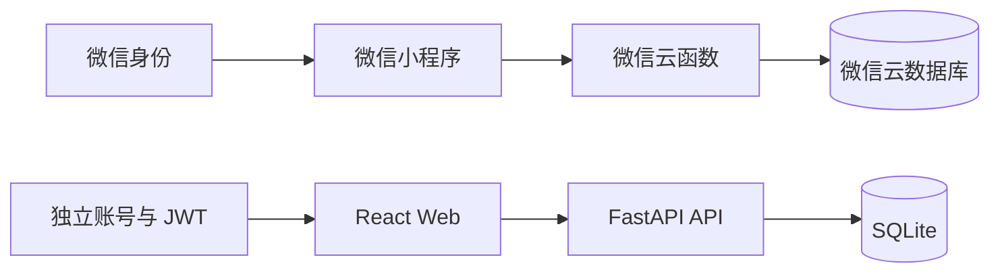

# 双端架构

## 同一产品，两个独立系统

小程序与 Web 不直接调用彼此的后端。没有账号映射、跨端同步或共用数据库。评分参数也由各自历史实现定义。

## 小程序 v6.7

app.js 初始化云开发、登录、全局状态和云函数调用，同时协调本地保存与网络恢复同步。app.json 注册 13 个页面；底部导航为首页、记录、数据、建议、成就，森林为独立页面。

| 云函数 | 主要职责 |
| --- | --- |
| login | 微信身份与用户初始化 |
| saveAction | 行为保存、评分与反馈、挑战领取处理 |
| deleteAction | 删除记录并调整相关数据 |
| getWeekStats | 周统计 |
| getMonthHistory | 月历史 |
| getForest | 树木列表 |
| getLeaderboard | 排行列表 |
| updateProfile | 资料更新 |

common 是共享模块，不计入第 9 个业务云函数。原部署结构要求 users、actions、trees、challengeClaims 四个集合。同步队列保留未同步行为，网络恢复后再尝试提交；原有检查见 tests/。

建议按 app.js → pages/record/record.js → cloudfunctions/saveAction/index.js → common/index.js → getWeekStats/getForest 的顺序阅读。

## Web v5.0

React Router 注册 10 个路由：导览、登录、注册、首页、记录、数据、成就、森林、排行榜和个人资料。AuthContext 管理身份，AuthGuard 控制受保护页面，services 封装 /api 请求。

后端 main.py 组织 auth、records、stats、forest、leaderboard、profile 路由。SQLAlchemy 管理 users、actions、trees，SQLite 保存数据。GET /api/health 是健康接口；本地 Vite 将 /api 代理到 localhost:8000。

记录链路：前端选项 → records 服务 → 后端账号校验与评分 → actions/trees/用户积分更新 → 统计或森林查询 → 页面反馈。关键文件为 src/pages/Record.tsx、src/services/records.ts、backend/routers/records.py、backend/carbon_algorithm.py、backend/models.py。

AIChat 调用 src/knowledge/index.ts 中的本地规则响应；名称中的 AI 不表示已经集成远程模型。

## 本次公开的配置边界

原 AppID 与云环境已替换为占位或空值。Web 只带 .env.example，没有原数据库、服务器配置或运行凭据。停止服务后，这些源码关系仍可阅读，但不意味着原后端可以继续访问。
